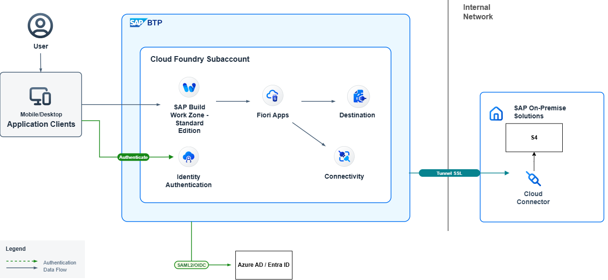
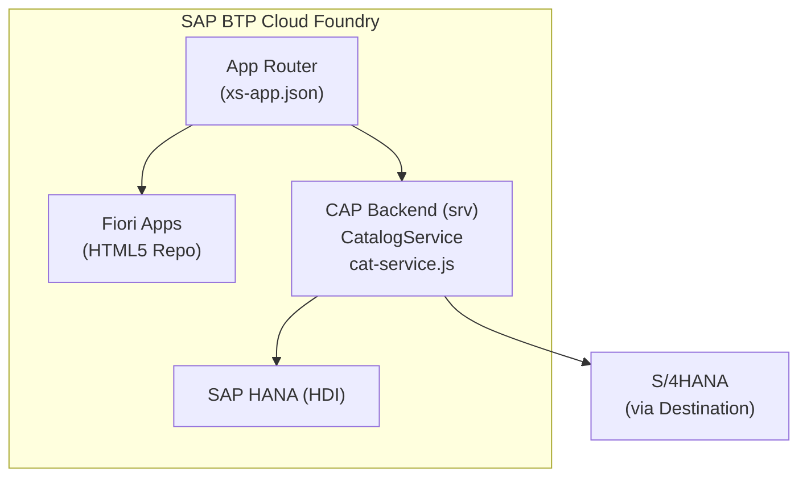
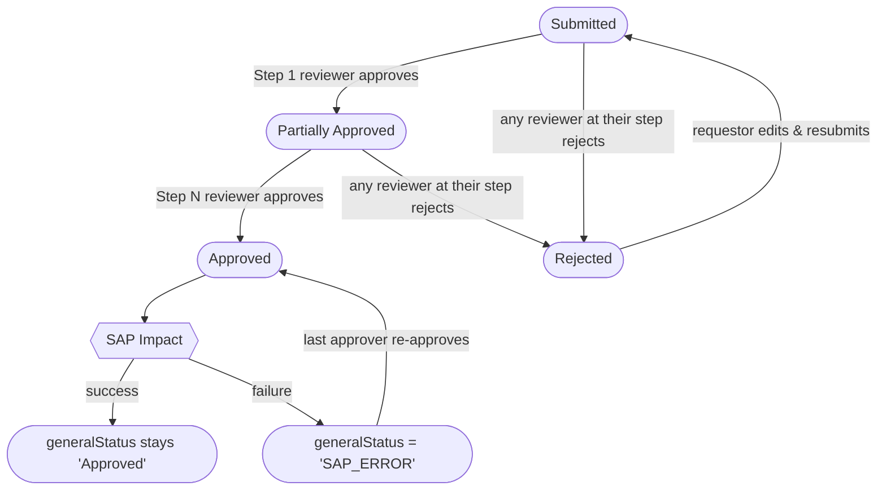
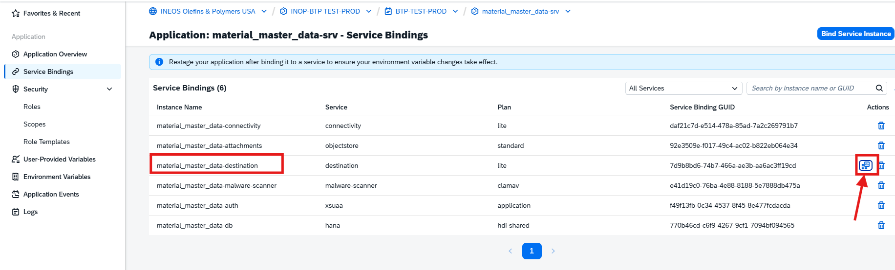
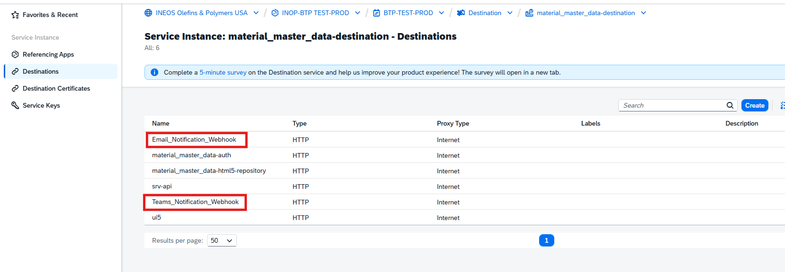

# Material Master Data — Project Documentation

## Overview

Material Master Data (MMDA) is a SAP BTP full-stack application built with **SAP CAP (Cloud Application Programming)** that digitizes and manages the approval workflow for material master data requests. It replaces a manual process in which plant operations staff submitted requests to create, change, or delete SAP material master records.

The application covers five request types, routes each through a configurable hierarchical approval chain, and — upon final approval — creates or updates the material in the connected S/4HANA system via OData APIs.

---

## Tech Stack

| Layer | Technology |
|---|---|
| Framework | SAP CAP (`@sap/cds` v9) |
| Runtime | Node.js on SAP BTP Cloud Foundry |
| Database | SAP HANA (HDI container) / SQLite (local/test) |
| Frontend | SAP Fiori Elements (SAPUI5) |
| Auth | SAP XSUAA (OAuth2) |
| SAP integration | OData v2 via SAP Cloud SDK + Destination Service |
| File storage | SAP Object Store (malware-scanned attachments) |
| Scheduled jobs | `node-cron` |
| Tests | Node.js built-in `node:test` runner |
| CI/CD | GitHub Actions → Cloud Foundry MTA deploy |

---

## Request Form Types

The core entity of the system is the **RequestForm**, which covers five distinct business processes:

| Code | Name | Purpose |
|---|---|---|
| `NewStock` | New Stock | Request creation of a new stocked material master |
| `NonStock` | Non-Stock | Request creation of a non-stocked material master |
| `SafetyStock` | Safety Stock Level Change | Request a change to the safety stock quantity of an existing material |
| `Deletion` | Deletion | Request marking an existing material for deletion |
| `NonToStock` | Non-Stock to New Stock | Convert an existing non-stock material into a stock material (extends the existing plant view; restricted to plants where the material already exists) |

Each type has a different set of required form fields. The `NewStock` form is the most complex, capturing procurement, storage, MRP, and valuation data; `Deletion` and `SafetyStock` require only a SAP material number, description, and plant. `NonToStock` reuses a reduced subset of the `NewStock` serviceability fields plus a reference to the existing material.

### Material Description

The field is never typed by hand — it is read-only in the UI and always derived on the server:

- `Deletion` / `SafetyStock` / `NonToStock` copy it from the selected existing material (`I_Product.Product_Text`).
- `NewStock` / `NonStock` derive it on activation from the first three CHAR characteristics of the selected class, joined with `, ` (`*` when none carry a value).

SAP's `ProductDescription` is limited to 40 characters and holds uppercase text, so the derived value is uppercased and cut to the last complete word that fits. Both run at derivation time, so the requestor and every reviewer see and approve the exact text that will reach SAP, and after a successful creation the description SAP returns is written back to the form. The value copied from an existing material (`Deletion` / `SafetyStock` / `NonToStock`) is left exactly as SAP returns it — those types never write a description back.

### Field Restrictions

- **Estimated Delivery Time** (`RequestForm.estDeliveryTime`) is capped to 3 digits (0–999).
- **Safety Stock Requested** (`RequestForm.safetyStockReq`) only accepts digits.
- **Storage Bin** (`MaterialCreationValues.storageBin`) is uppercased on save, so what admins configure matches what SAP stores.

The first two are enforced with CDS validation annotations (`@assert.range`, `@assert.format`), which the compiler also turns into OData `Validation.Minimum`/`Maximum`/`Pattern` — Fiori Elements surfaces the same rule client-side, no custom UI code needed. The storage bin uppercasing runs alongside the other config normalization in `before('SAVE','MaterialCreationValues')`.

---

## Architecture

### System Landscape

Users reach MMDA through the **SAP Build Work Zone** launchpad, and every request is authenticated and authorized before it reaches the CAP service.



**Authentication and role assignment, end to end:**

1. **Access** — The user opens a Fiori app from Build Work Zone. The App Router protects every route with **XSUAA** (OAuth2); an unauthenticated request is redirected to log in.
2. **Trust (XSUAA → IAS)** — The BTP subaccount trusts **SAP Identity Authentication (IAS)** as its identity provider, so XSUAA delegates the actual login to IAS rather than authenticating users itself.
3. **Federation (IAS → Entra ID)** — IAS does not hold the users; it is configured with **Azure AD / Entra ID** as the corporate identity provider over **SAML 2.0 / OIDC**. IAS brokers the login to Entra, where the user authenticates with corporate credentials.
4. **Group claims (Entra → IAS)** — On a successful login, Entra returns an assertion that includes the user's **group memberships** as a claim. IAS receives them and passes them on.
5. **Group propagation (IAS → XSUAA)** — IAS issues its own assertion to XSUAA, carrying the groups in the **`Groups`** assertion attribute.
6. **Group → Role Collection mapping** — XSUAA matches the user's group to its assigned **Role Collections**. Each group maps to two of them:
   - a **backend** collection that grants the user's role in the service — Requestor, Reviewer, or Manager;
   - a **`_ui`** collection that controls which app tiles the user sees in Work Zone.

   See [Role Collections & Work Zone Access](#role-collections--work-zone-access) for the complete mapping.

### Component View



### Backend (`srv/`)

A single **CatalogService** (`cat-service.js`) handles all business logic:

- **Before hooks** — draft lifecycle (NEW/SAVE/EDIT) for RequestForm: field validation, status transitions, resubmission cleanup
- **Action handlers** — `approveRequest` and `rejectRequest` OData actions that drive the approval state machine
- **Read handlers** — custom READ for `ApprovalFlow` (virtual entity), `RequestForm` (injects `isReviewPending` / `isFormEditable` virtual fields, expands external data), and all external SAP entities
- **SAP impact** — on final approval, `_handleMaterialCreation`, `_handleSafetyStockChange`, or `_handleNonToStockConversion` calls S/4HANA to create/update the material
- **Scheduled job** (`jobs.js`) — daily cron at midnight scans for forms pending approval for more than N days (configurable via `REMINDER_DAYS_LIMIT`) and logs escalation notifications

### Frontend (`app/`)

Five independent SAP Fiori Elements applications, each with its own `manifest.json`, `annotations.cds`, and UI5 build:

| App folder | Purpose | Audience |
|---|---|---|
| `req_material_master_data` | Main form — submit and track material requests | Requestors |
| `maintain_hierarchy` | Configure the per-plant, per-form-type approval chain | Managers |
| `maintain_planning_lead` | Configure BOM/InfoRecord planner contacts for post-approval notifications | Managers |
| `characteristic_configuration` | Configure which SAP characteristics should use a value list in the form | Managers |
| `material_creation_values` | Configure the SAP field defaults used for material creation per plant/type/cost | Managers |

#### UI5 Versions

All apps run on **1.136** except `material_creation_values`, which runs on **1.148**.

| App folder | UI5 version | Maintenance support until |
|---|---|---|
| `req_material_master_data` | 1.136 | 2033 |
| `maintain_hierarchy` | 1.136 | 2033 |
| `maintain_planning_lead` | 1.136 | 2033 |
| `characteristic_configuration` | 1.136 | 2033 |
| `material_creation_values` | 1.148 | 2028 |

Support end dates per the [SAPUI5 Version Overview](https://ui5.sap.com/versionoverview.html). 

### Database (`db/`)

Defined in `schema.cds` under the `my.MaterialMasterData` namespace. All internal entities use `cuid` (UUID) as primary key and `managed` for audit fields (`createdAt`, `createdBy`, etc.).

---

## Data Model

```
RequestForm
 ├── formType (→ FormType)
 ├── plant (→ ConfiguredPlants view)
 ├── attachments (Composition → CAP Attachments)
 ├── toFormApprovalSteps (→ FormApprovalSteps[])
 └── toReviewHierarchy (→ ReviewHierarchy[])

ReviewHierarchy
 ├── plant (→ SAP A_Plant)
 ├── formType (→ FormType)
 ├── step: Integer
 └── reviewer: String (email)

FormApprovalSteps        ← immutable audit log, one row per decision
 ├── parentForm (→ RequestForm)
 ├── step: Integer
 ├── status: APPROVED | REJECTED
 ├── reviewedBy: String (email)
 └── reviewedAt: DateTime

MaterialCreationValues   ← lookup table for SAP field defaults
 ├── requestPlant, formType
 ├── repairableStatus, costOperator, costThreshold  ← matching filters
 └── ~25 SAP field defaults (MRP, valuation, purchasing, storage, etc.)

PlanningLead             ← contacts for post-approval notifications
CharacteristicConfig     ← local config for SAP characteristics
ConfiguredPlants (view)  ← derived from ReviewHierarchy
```

---

## Approval Flow

The approval process is **plant + form-type specific** and configured in `ReviewHierarchy`. Each row assigns one reviewer email to one step number for a given plant/form-type pair. Multiple rows at the same step number means **any one of them** can advance the form.



Key rules enforced in service code:
- Only the reviewer at the **current step** can approve or reject
- A reviewer can only edit the form at **step 1** or when retrying after `SAP_ERROR` (last step only)
- After final rejection, approval history is cleared on resubmission
- The virtual `ApprovalFlow` entity merges the hierarchy config with actual `FormApprovalSteps` to show a complete pending/done timeline in the UI

---

## Notifications

The application notifies requestors, reviewers, and planners as a request moves through its lifecycle. All notifications are delivered through **Microsoft Power Automate flows** rather than sent directly by the backend — the CAP service simply POSTs a payload to a flow's HTTP trigger, and Power Automate handles the actual delivery to email inboxes and Microsoft Teams.

### Service structure (`srv/notifications/`)

Three layered services separate orchestration from delivery:

| Service | File | Responsibility |
|---|---|---|
| **Notification Service** | `notificationService.js` | Orchestration. Exposes one method per business event (submitted, pending action, rejected, final approved, SAP error, reminders, planner notifications). Resolves recipients, builds the email HTML and the Teams Adaptive Card, then fans the message out to both channels. |
| **Mail Service** | `mailService.js` | Delivery to email. POSTs `{ to, subject, body }` to the email Power Automate flow. |
| **Teams Service** | `teamsService.js` | Delivery to Microsoft Teams. POSTs `{ recipient, type, attachments }` (an Adaptive Card) to the Teams Power Automate flow. |

The Notification Service dispatches to both channels with `Promise.allSettled`, so a failure in one channel never blocks the other. A shared `util.js` provides recipient normalization and retry-with-backoff helpers.

### Power Automate integration

#### General

All outbound messaging is delegated to **Microsoft Power Automate** cloud flows hosted in the **`INEOS USA LLC (default)`** environment. The CAP simply hands a ready-to-send payload to a flow over HTTP, and the flow performs the actual send using its own connectors. This keeps mail and Teams credentials inside Power Automate.

| Flow name (Power Automate) | Channel | Trigger | Flow action |
|---|---|---|---|
| `email sending from http hook` | Email | *When a Teams webhook request is received* | Sends an email from the request body's `to` / `subject` / `body` fields |
| `teams card sending from http hook` | Teams | *When a Teams webhook request is received* | "Post card in a chat or channel" **as the Flow bot**, using the Adaptive Card in `attachments[0].content` |

Both flows appear under **"Shared with me"** — ownership stays with the messaging/IT team, and the integration account is granted trigger access rather than owning the flows.

> ⚠️ **Both flows require a connection to a Microsoft 365 user account (email).** The flows post as the **Flow bot**, but the connector is authenticated against a licensed user mailbox. The delivery runs entirely under that account's connection: if the account is not available **every notification fails** until the connection is re-authenticated (**Change connection** in the flow). The account can be swapped, but there must always be a valid, licensed user connection behind the flow.

#### Integration

Each delivery is a single **HTTP POST** from the backend to the flow's trigger URL:

- **Email payload** (`mailService.js`) — `{ to, subject, body }`, where `body` is pre-rendered HTML.
- **Teams payload** (`teamsService.js`) — `{ recipient, type, attachments }`, where `attachments[0].content` is the Adaptive Card.
- **Auth** — the flow's shared-access signature (SAS) is read from the destination's **password** field and appended as a `sig` **query parameter** (the code adds the `sig=` key itself — `config.params = { sig }` in `mailService.js`/`teamsService.js` — and axios URL-encodes the value, so the password stores the bare signature). The SDK's default `Authorization` header is stripped so it does not collide with the flow's own SAS auth.
- **Resilience** — requests use **retry with exponential backoff** on transient errors (408, 429, 502, 503, 504). The Notification Service fans both channels out with `Promise.allSettled`, so an email failure never blocks the Teams send (and vice-versa).
- **Response semantics** — a **`202 Accepted`** means Power Automate *queued* the run; it is **not** a delivery confirmation. Actual send success or failure is visible only in the flow's run history (see [Troubleshooting](#troubleshooting)).

#### Destinations

The backend never hard-codes a flow URL. Each channel resolves an **SAP Destination** at runtime via the SAP Cloud SDK; the destination holds the flow's HTTP-trigger URL and the signature secret (in the destination's password field).

| Channel | Destination name | Holds |
|---|---|---|
| Email | `Email_Notification_Webhook` | Trigger URL of `email sending from http hook` + signature secret |
| Teams | `Teams_Notification_Webhook` | Trigger URL of `teams card sending from http hook` + signature secret |

Because the URL and secret live in the destination, rotating a flow (new URL or SAS) is a **destination config change only** — no code change and no redeploy.

#### Where to find them in BTP

The destinations are **declared in `mta.yaml`** and created automatically as part of the `material_master_data-destination` service instance when the app is deployed. After deployment they are managed in the **BTP Cockpit**, reached from the app's **Service Bindings** (open the `material_master_data-destination` binding):



That opens the destination service instance, whose **Destinations** tab lists all destinations — including `Email_Notification_Webhook` and `Teams_Notification_Webhook`:



> **The signature must be set manually.** The MTA creates each destination with its name, type, and URL, but the Power Automate **signature secret is not part of the deployment** — it has to be entered by hand in the destination's **`Password`** field via the cockpit. This is a **one-time** step done after the destination is first created; the value then **persists** across app restarts and redeploys (repeat only if the flow's SAS is rotated).
>
> **Enter only the bare signature — not `sig=…`, and not URL-encoded.** The flow's trigger URL ends with `…&sv=…&sig=<signature>`. Copy **only the `<signature>`** (everything after `sig=`) into the `Password` field. The backend adds the `sig=` key and URL-encodes the value when it builds the request, so:
> - ✅ `Password = <signature>` → request gets `?sig=<signature>` (correct)
> - ❌ `Password = sig=<signature>` → request gets `?sig=sig%3D<signature>` and the flow rejects it
>

### Notification events

| Event | Trigger | Recipients |
|---|---|---|
| Submission confirmation | Request submitted | Requestor |
| Action required | Request reaches a reviewer's step | Reviewers at the current step |
| Rejected | A reviewer rejects | Requestor, prior approvers, the rejector |
| Final approval | Request fully approved and processed in SAP | Requestor and all reviewers in the hierarchy |
| SAP error | SAP material creation/update fails | Final approver who triggered the approval |
| Reminder | Request pending longer than `REMINDER_DAYS_LIMIT` (daily cron, `jobs.js`) | Reviewers at the current pending step |
| SAP-error escalation | Request stuck in `SAP_ERROR` past the threshold (daily cron) | Final approver |
| Planner notifications | New material created — BOM and InfoRecord planners (see `PlanningLead`) | Configured planner contacts for the plant |

---

## External SAP Integrations

All external services connect via an SAP Destination:

| Internal name | SAP API | Used for |
|---|---|---|
| `plant` | `API_PLANT_SRV` (OData v2) | Plant value help, plant name lookup |
| `class` | `API_CLFN_CLASS_SRV` (OData v2) | Material class and class-characteristic lookup |
| `characteristic` | `API_CLFN_CHARACTERISTIC_SRV` (OData v2) | Characteristic metadata and allowed values |
| `material` | `API_PRODUCT_SRV` (OData v2) | Material **creation** (POST with CSRF) |
| `material2` | `MD_C_PRODUCT_MAINTAIN_SRV` (OData v2) | Material/product search, UoM, material groups, safety stock update |
| `vendor` | `API_BUSINESS_PARTNER` (OData v2) | Supplier value help |

In **test** mode, all external services are replaced by CDS `app-service` mocks backed by CSV fixture files in `test/data/`.

---

## Authorization Model

Three roles, enforced at the OData service layer via CDS `@restrict` annotations:

| Role | RequestForm | Config entities | Actions |
|---|---|---|---|
| `REQUESTOR` | READ (own), CREATE, UPDATE (own, in Draft/Submitted/Rejected) | None | None |
| `REVIEWER` | READ + UPDATE (only forms in their hierarchy) | READ ReviewHierarchy, MaterialCreationValues | `approveRequest`, `rejectRequest` |
| `MANAGER` | READ only | Full CRUD on all config entities | None |

Additionally, the service enforces **step-level authorization** in JavaScript: even a REVIEWER with the correct role is rejected (403) if they are not the configured reviewer for the form's current step.

### Role Collections & Work Zone Access

Every user belongs to a single **corporate group** in Entra ID, and that group grants **two role collections** at once: a **backend** collection (the OData permissions in the table above) and a matching **`_ui`** collection that controls **which app tiles the user sees in SAP Build Work Zone**. Separating the two means the launchpad only shows the screens relevant to a user's job, *and* the service independently enforces what that user is allowed to do.

**Functional summary:**

- **Requestor** — the everyday user. Opens the request app, raises a new material request, and follows their own requests through the approval process.
- **Reviewer** — an approver. Opens the same request app to review the requests waiting on them and approve or reject at their step.
- **Manager** — the administrator. Sees every app, maintains the configuration that drives the whole process (approval chains, planner contacts, characteristics, material-creation defaults), and can view all requests.

**How to read the table:** each Entra ID group appears on **two rows — read them as a pair**. The row with the plain role collection describes the **backend** access the group receives; the row with the `_ui` role collection describes the **Work Zone (frontend) tiles** it receives. The IAS group carries the same name because it is propagated unchanged through Identity Authentication (see [System Landscape](#system-landscape)).

| Entra ID group | IAS group | Role collection | Backend | Frontend (Work Zone) | Description |
|---|---|---|---|---|---|
| `Material_MD_Request_Creator` | `Material_MD_Request_Creator` | `material_md_request_creator` | CREATE requests; READ; UPDATE **own** requests while in Draft, Submitted, or Rejected | — | **Requestor — backend.** Can raise new material requests and track or edit their own. |
| `Material_MD_Request_Creator` | `Material_MD_Request_Creator` | `material_md_request_creator_ui` | — | Sees the **main request app** (`Material Master Requests`) | **Requestor — Work Zone.** Access to the one screen where requests are submitted and tracked. |
| `Material_MD_Request_Reviewer` | `Material_MD_Request_Reviewer` | `material_md_request_reviewer` | READ / UPDATE requests **in their approval hierarchy, when business rules are matched**; run `approveRequest` / `rejectRequest` | — | **Reviewer — backend.** Can open the requests assigned to them and approve or reject at their step. |
| `Material_MD_Request_Reviewer` | `Material_MD_Request_Reviewer` | `material_md_request_reviewer_ui` | — | Sees the **main request app** (`Material Master Requests`) | **Reviewer — Work Zone.** Access to the request app where approvals are done. |
| `Material_MD_Approval_Flow_Manager` | `Material_MD_Approval_Flow_Manager` | `material_md_approval_flow_manager` | Full CRUD on **all configuration entities**; READ on the main `RequestForm` entity | — | **Manager — backend.** Sets up and maintains the configuration that drives the process, and can view (but not act on) requests. |
| `Material_MD_Approval_Flow_Manager` | `Material_MD_Approval_Flow_Manager` | `material_md_approval_flow_manager_ui` | — | Sees **all five apps** — the four configuration apps + the main request app | **Manager — Work Zone.** Access to every screen, to administer the whole application. |

> The `_ui` role collections are maintained in **Build Work Zone**, not in `xs-security.json`; they gate tile visibility only and grant no service permissions. The plain (backend) collections are the three defined in `xs-security.json` and shown in the [Authorization Model table above](#authorization-model).

---

## Material Creation Values

When a `NewStock` or `NonStock` form is finally approved, the service selects the correct row from `MaterialCreationValues` using three filters derived from the form:

1. **Plant** — the plant selected on the form
2. **Repairable status** — `Repairable` / `Not Repairable` (NewStock only)
3. **Cost threshold** — `<` or `>` a configured dollar amount

The matching row provides ~25 SAP field defaults (material type, MRP group, purchasing group, valuation class, price control, storage location, etc.) that are combined with user-entered fields to construct the `API_PRODUCT_SRV` deep-insert payload.

`NonToStock` also draws its SAP defaults from this table, but matches its row **directly** by plant + `NonToStock` + repairable status (no cost-band filter, since NonToStock rows are cost-agnostic). Because a Non-Stock to New Stock request only updates an existing material's plant view, it applies a reduced subset of the row (cross-plant status, purchasing group, MRP settings, storage bin) via targeted OData updates rather than a full deep-insert.

---

## Infrastructure & Deployment

Deployed as an **MTA (Multi-Target Application)** to SAP BTP Cloud Foundry. Key BTP services consumed:

| BTP Service | Purpose |
|---|---|
| XSUAA | Authentication and role management |
| SAP HANA HDI | Persistent database |
| HTML5 App Repository | Hosts the Fiori bundles |
| Destination Service | Manages the connection to S/4HANA |
| Connectivity Service | On-premise tunnel |
| Object Store | Attachment file storage |
| Malware Scanner | Scans uploaded attachments (ClamAV) |

---

## Configuration (Environment Variables)

Application behaviour is tuned through **environment variables**. They are **not** declared in `mta.yaml`; the `material_master_data-srv` module sets `keep-existing: { env: true }`, so the values are applied **directly on the Cloud Foundry app** (BTP Cockpit → *User-Provided Variables*) and **persist across redeploys** — the same "set once, persists" pattern used for the destination signatures. Locally and in tests they are read from a `.env` file.

| Variable | Purpose | Default if unset | Read in |
|---|---|---|---|
| `MATERIAL_CLASS_TYPE` | SAP class-type filter for the `MaterialClass` value help and the `CLASSTYPE` on `BAPI_OBJCL_CHANGE` | `001` | `srv/cat-service.js` |
| `MATERIAL_TYPE` | SAP product-type filter for the `Material2` search | `ERSA` | `srv/cat-service.js` |
| `REMINDER_DAYS_LIMIT` | Days a form may stay pending / in `SAP_ERROR` before the daily cron escalates | `7` | `srv/jobs.js` |
| `MMDA_APP_URL` | URL template (with a `{{ID}}` placeholder) for the review deep-link in notifications | *empty — review links break if unset* | `srv/notifications/notificationService.js` |
| `NOTIFY_NEWSTOCK` | Enable reviewer "action required" notifications for `NewStock` (only when set to `TRUE`) | *off* | `srv/cat-service.js` |
| `NOTIFY_NONSTOCK` | Same, for `NonStock` | *off* | `srv/cat-service.js` |
| `NOTIFY_SAFETYSTOCK` | Same, for `SafetyStock` | *off* | `srv/cat-service.js` |
| `NOTIFY_DELETION` | Same, for `Deletion` | *off* | `srv/cat-service.js` |
| `NOTIFY_NONTOSTOCK` | Same, for `NonToStock` | *off* | `srv/cat-service.js` |

**Notes**

- The five `NOTIFY_*` flags are resolved dynamically as `NOTIFY_${formType}` and compared case-insensitively to `TRUE`. Any other value — or leaving it unset — **disables** the reviewer "action required" notification for that form type; requestor and approval notifications are unaffected.
- `SUPPLIER_ROLE` also appears in `.env` but is currently **unused** (no code references) — omitted from the table above. Remove it, or wire it up if it was intended for the supplier value help.
- Platform variables (`VCAP_SERVICES`, `PORT`, `NODE_ENV` / `CDS_ENV` profiles) are injected and consumed automatically by CAP / Cloud Foundry — you do not set them manually.

### CI/CD variables

The GitHub Actions workflows in `.github/workflows/` use their own variables (repo/environment settings, not app runtime): `APP_NAME` (literal `material_master_data`), `vars.CF_API` / `CF_ORG` / `CF_SPACE` / `CF_USERNAME`, and the secrets `CF_PASSWORD`, `REMOTE_SSH_KEY`, and `REMOTE_REPO_SSH_URL`.

---

## Testing

Tests use the **Node.js built-in `node:test`** runner (not Jest) with `@cap-js/cds-test` for CDS integration.

| File | Coverage area |
|---|---|
| `roles.test.js` | Full RBAC and approval flow integration tests (main test suite) |

External SAP services are fully mocked via CDS `app-service` fixtures. The two SAP write operations (`_executeSAPMaterialCreate`, `_executeSAPSafetyStockUpdate`) are mocked at the service instance level using `mock.method()` from `node:test`.

Run with: `npm run test`

---

## Troubleshooting

| Symptom | Likely cause / what to check |
|---|---|
| An external query fails | SAP may not be responding — check the connected S/4HANA system and that the relevant Destination is reachable. |
| Email or Teams notification delivery fails | Check the respective **Power Automate flow** — review its run history for failed or stuck runs. For **Teams**, also confirm the flow's connection to its Microsoft 365 user account is still valid (licensed and not revoked). |
